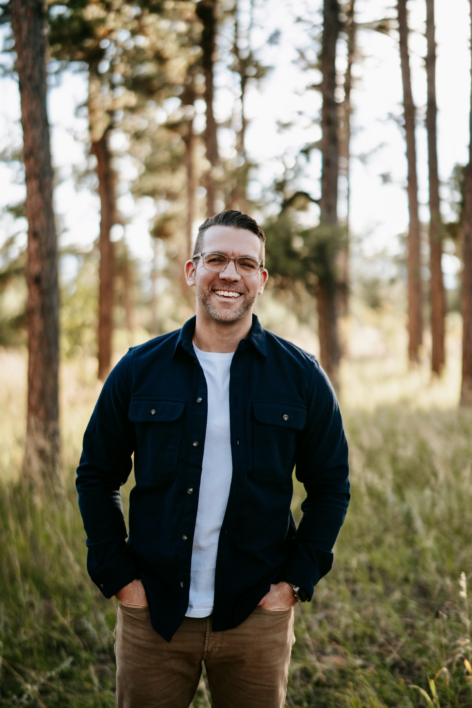

I share biblical resources for everyday discipleship. On this site you'll find my guides to Logos Bible Software, my latest videos and my newsletter, where I highlight current Logos sales.

<a class="about-tile" href="/logos-buyers-guide/">Logos Buyer's GuideWhich Logos library should you buy?</a>
<a class="about-tile" href="/logos-discounts/">Logos DiscountsThe best Logos discounts and buying tips.</a>
<a class="about-tile" href="https://youtube.com/nickstapleton">YouTubeLogos tips, books, answers to questions and other resources to help Christians grow as disciples.</a>
<a class="about-tile" href="https://nickstapleton.kit.com">NewsletterCurrent Logos sales, free books and my favorite resources on sale.</a>

## About me

I live with my wife and three sons in Colorado where I spend the best part of my week [making disciples on college campuses](https://stapleton.sococru.com) by sharing the gospel, teaching the Bible, and equipping the saints for ministry.

I have an MDiv from Trinity Evangelical Divinity School.

I am passionate about the Bible, theology, discipleship, and good gifts in life like black coffee, learning, friendship, reading, and Graeter's black raspberry chip ice cream.
