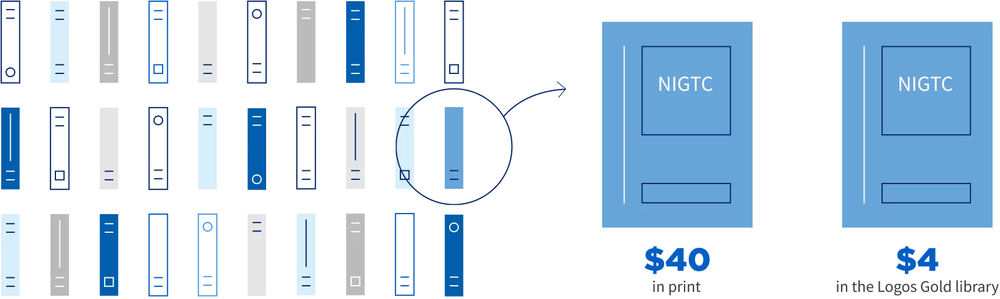

## Overview

Logos has been one of the best investments I've ever made. It's an invaluable tool for learning, seminary, Bible study, sermon prep, and ministry.

I've used Logos almost daily for over 15 years, relying on it heavily during my MDiv program in seminary, and it continues to play a signficant role today in my ministry and personal growth. My perspective will be most helpful for pastors, seminary students, and other vocational ministers who have already decided they want to invest in Logos.

If you're new to Logos or looking to go deeper, you may be wondering:

* _Which Logos subscription and library should I buy?_
* _Are there any Logos discounts or tips for getting the best deal?_
* _Which resources or features are essential?_

In this post, I'll help you choose the best Logos subscription and library based on your needs. 

**In a hurry? Here are my picks.**

| If you are... | Subscription | Library |
|---|---|---|
| A pastor or teacher on a budget | Logos Pro | [Preacher Gold](https://logos.sjv.io/c/135250/2524153/26054?sharedid=guide&u=https://www.logos.com/product/420441) |
| Ready for top-tier commentaries | Logos Pro | [Nick Stapleton Study Bundle](https://logos.sjv.io/c/135250/2524153/26054?sharedid=guide&u=https://www.logos.com/partner/nick-stapleton) |
| A seminary student | Logos Max | [Nick Stapleton Study Bundle](https://logos.sjv.io/c/135250/2524153/26054?sharedid=guide&u=https://www.logos.com/partner/nick-stapleton) |

**[Start with an extended 60-day free Logos trial using my link](https://logos.sjv.io/c/135250/2524153/26054?sharedid=guide&u=https://www.logos.com/partner/nick-stapleton).** [^1]

## Which Logos Subscription and Library Should I Buy?

Ultimately, there are three questions you need to answer:

1. **✨ What features do I want?** (Determines your subscription)
2. **📚 What resources do I want?** (Determines your library)
3. **💵 What is my budget?**

**Logos is only as useful as the resources and features you have inside of it.** If you want to access the top commentaries, lexicons, and Bible dictionaries, you need to have them in Logos.

When I first purchased Logos in 2009, I bought an entry-level library and expected it to somehow perform exegetical magic. Eventually, I realized that Logos isn’t going to magically revolutionize my study of the Bible simply by buying any package.

> **_You need to know what you want Logos to do for you and ensure you are getting the right features and resources to accomplish your desired task._**

## Logos Subscriptions Overview

Logos offers three subscription tiers: Premium, Pro, and Max.

Each tier is tailored to different use cases:
- **Logos Premium**: Small group prep
- **Logos Pro**: Pastoral ministry sermon prep, and preaching
- **Logos Max**: Academic and original language study

With any subscription, you'll get:
- Ongoing feature updates every six weeks
- Cloud and AI feature access
- Mobile Ed Courses
- Reward perks:
	- 5% store-wide discount on books
	- A subscriber-only free book each month
	- 5% annual reward coupon every February (Pro and Max only)
	- Logos online sermon database (Pro and Max only)

### Why I Like Logos Subscriptions

🔷 Logos subscriptions work differently. When you stop paying for your Netflix subscription, you lose all access to Netflix. That's **not** how Logos subscriptions work.

🔷 If you owned a Logos 10 or earlier package and subscribed before December 7, 2026, you earn a Legacy Fallback License by staying subscribed for 24 consecutive months. If you're new to Logos, this doesn't apply to you.

🔷 A **Legacy Fallback License** allows you to keep offline features when you cancel your subscription. **Instead of falling back to a free or previous version of Logos, you'll keep the core features from your subscription tier that don't rely on the cloud or AI.**

🔷 Logos subscription model provides a lower price of entry, continuous upgrades, and faster feedback for better product development. It's a rare instance where a subscription truly adds value.

And again, any books, features, or content you purchase are yours forever and accessible regardless of your subscription status.

### Pricing

The price for each subscription tier varies, with Premium the least expensive and Max the most. Logos adjusts subscription pricing from time to time (the latest change is dated December 7, 2026), so rather than list numbers that go stale, here is [Logos's current subscription pricing](https://logos.sjv.io/c/135250/2524153/26054?sharedid=guide&u=https://www.logos.com/configure/subscriptions).

A great way to save money is by paying upfront. Logos discounts annual plans, and if you pay for two years you get 24 months for the price of 19.

If want to try any of these subscriptions risk-free, you can use my link and get **[an extended 60-day free trial subscription!](https://logos.sjv.io/c/135250/2524153/26054?sharedid=guide&u=https://www.logos.com/partner/nick-stapleton)** [^1]

If you own a Logos 10 or earlier package, you are eligible for a cheaper subscription price because you've previously purchased features in Logos. Logos will show you your price at checkout.

## Logos Subscription Recommendations

As mentioned earlier, the three subscription tiers cater to distinct needs. Understanding these use-cases will help you pick the best option for your purposes. My recommendation: I suggest anyone who is going to be using Logos regularly, especially those in ministry and seminary, get at least Logos Pro. That's the subscription tier I use.

---

### 📖 Logos Premium
- **Recommended For**: Lay leaders, Sunday school teachers, and small group leaders
- **Empowers**: Teaching others in small group settings
- **Bible Study Tools**: Intermediate-level tools for personal study and group preparation
- **Original Languages**: Limited access—only through English Bible translations

---

### 👨‍🏫 Logos Pro
- **Recommended For**: Pastors, teachers, and vocational ministers
- **Empowers**: Teaching, preaching, pastoring, and counseling
- **Bible Study Tools**: Advanced tools for sermon prep, teaching, and deeper Bible study
- **Original Languages**: Intermediate-level Greek and Hebrew morphological tools
- **Also**: Includes resources for studying the Deuterocanonicals

---

### 👨‍🎓 Logos Max
- **Recommended For**: Seminary students, academics, and those pursuing original language study
- **Empowers**: Advanced research, seminary study, and academic paper writing
- **Bible Study Tools**: Advanced tools for comprehensive research and in-depth Bible study
- **Original Languages**: Advanced Greek, Hebrew grammar, syntax, plus Latin, Syriac, and more
- **Also**: Access to every current Logos feature, including studies on the Deuterocanonicals, Septuagint, Vulgate, Dead Sea Scrolls, and more

---

✨ **Use my Logos affiliate link to get an [extended 60-day free trial on a Logos subscription](https://logos.sjv.io/stapleton?sharedid=guide)!**

## Logos Libraries Overview

Logos libraries are the most cost-effective way to build your resource library. Here's why:

**According to Logos, their libraries save you 90% compared to purchasing books individually.**

You don't need a subscription to buy a library, and libraries come with perpetual licenses. This means even if you cancel your subscription, you'll keep access to the books you’ve purchased.

When I first started with Logos, I hesitated to buy libraries, thinking they were overpriced and full of resources I’d never use. However, I've learned that while you may not use every resource that comes with your library, you will get others you want at a steep discount. You can buy resources individually, but you’ll likely spend far more money in the long run.

Worst-case scenario with a Logos library: you get the resources you want and hundreds more at little or no extra cost.

Additionally, you will never pay for a resource twice. When you buy a Logos resource, it is yours forever. With dynamic pricing, Logos will prorate the price of any library you purchase if you already own a given resource in your Logos library.

## Logos Library Recommendations

### 💰 Best Budget Library

If you're seeking to balance between resources and affordability, Logos [Preacher Gold](https://logos.sjv.io/c/135250/2524153/26054?sharedid=guide&u=https://www.logos.com/product/420441) and [Standard Gold](https://logos.sjv.io/c/135250/2524153/26054?sharedid=guide&u=https://www.logos.com/product/420425) are the winners. These libraries provide a comprehensive Bible study toolkit, including excellent commentaries, Bible study resources, and systematic theology works — perfect for pastors, preachers, and anyone wanting to dive deeper into Scripture.

#### [Preacher Gold](https://logos.sjv.io/c/135250/2524153/26054?sharedid=guide&u=https://www.logos.com/product/420441)

<figure style="width: 250px" class="align-right">
  
</figure> 

- **Pillar New Testament Commentary - PNTC (18 vols.):** A premier scholarly series that blends rigorous exegesis with a clear focus on the theological message of the New Testament authors.
- **ESV Expository Commentary Series (12 vols.):** A clear, concise, and biblically sound resource designed to help pastors and students apply the text to modern life.
- **Christ Centered Exposition Commentary - CCE:** A practical and easy-to-read series that focuses on seeing every passage of Scripture through the lens of the gospel.
- **Tyndale Commentaries - TOTC/TNTC (47 vols.):** An accessible and classic set of commentaries that provides excellent introductory-level insights into both the Old and New Testaments.
- **The Concise Greek-English Lexicon of the New Testament:** A streamlined linguistic tool for quickly identifying the meaning and usage of Greek words in the biblical text.

#### [Standard Gold](https://logos.sjv.io/c/135250/2524153/26054?sharedid=guide&u=https://www.logos.com/product/420425)

<figure style="width: 250px" class="align-right">
  
</figure> 

- **ESV Expository Commentary Series (12 vols.):** A clear, concise, and biblically sound resource designed to help pastors and students apply the text to modern life.
- **Christ Centered Exposition Commentary - CCE:** A practical and easy-to-read series that focuses on seeing every passage of Scripture through the lens of the gospel.
- **Ancient Christian Doctrine Series (5 vols.):** A systematic exploration of the foundational beliefs of the early church, organized by the Nicene Creed.
- **Questions for Restless Minds (17 vols.):** A series of short, engaging books that provide thoughtful Christian perspectives on modern intellectual and social challenges.
- **Holman Illustrated Bible Dictionary:** A visually rich reference work that offers comprehensive definitions, maps, and photographs to bring the biblical world to life.

### 📚 Best Intermediate Library

I put together a study bundle with Logos for those seeking to do advanced exegesis and desiring access to top-tier commentaries, dictionaries, lexicons, and biblical reference works. Pound for pound, I think it is one of the best libraries available for the price. Many of my favorite resources are in this library. My biggest regret is that this library wasn't available for purchase when I was first building my Logos library!

#### [Nick Stapleton Study Bundle](https://logos.sjv.io/c/135250/2524153/26054?sharedid=guide&u=https://www.logos.com/partner/nick-stapleton)

<figure style="width: 250px" class="align-right">
  
</figure>

- **Pillar New Testament Commentary - PNTC (18 vols.)**
- **New International Commentary on the Old and New Testament - NIC (51 vols.)**
- **ESV Expository Commentary Series (12 vols.)**
- **The IVP Bible Dictionaries (8 vols.)**
- **Dictionary of Biblical Imagery**
- **The New Bible Dictionary, 3rd ed.**
- **IVP Pocket Reference Series**
- **New Studies in Biblical Theology Series Collection - NSBT (53 vols.)**
- **New Dictionary of Biblical Theology**
- **Calvin's Institutes of the Christian Religion (2 vols.)**
- **Charles Spurgeon Complete Sermon Collection (63 vols.)**
- **A Greek–English Lexicon of the New Testament and Other Early Christian Literature, 3rd ed. (BDAG)**

### 💎 Best Premium Library

These two are my favorite premium libraries. If you're committed to deep, scholarly study, and expositional preaching these libraries have you covered by offering access to fantastic commentaries and biblical reference works. 

#### [Preacher Diamond](https://logos.sjv.io/c/135250/2524153/26054?sharedid=guide&u=https://www.logos.com/product/420443)

<figure style="width: 250px" class="align-right">
  
</figure>

- **Pillar New Testament Commentary - PNTC (18 vols.):** A premier scholarly series that blends rigorous exegesis with a clear focus on the theological message of the New Testament authors.
- **New Studies in Biblical Theology Series Collection - NSBT (53 vols.):** An insightful collection of monographs that explores specific theological themes as they develop throughout the entire canon of Scripture.
- **ESV Expository Commentary Series (12 vols.):** A clear, concise, and biblically sound resource designed to help pastors and students apply the text to modern life.
- **Preaching the Word Commentary Series Collection - PtW (42 vols.):** A homiletically focused series written by pastors for pastors, prioritizing the faithful oral delivery of the Word.
- **John Calvin’s Commentaries Set (46 vols.):** A foundational collection of Reformation-era scholarship known for its clarity, brevity, and deep pastoral concern.
- **Apollos Old Testament Commentary - AOT (15 vols.):** A rigorous scholarly series that examines the Hebrew text while bridging the gap between the ancient world and contemporary application.

#### [Standard Diamond](https://logos.sjv.io/c/135250/2524153/26054?sharedid=guide&u=https://www.logos.com/product/420427)

<figure style="width: 250px" class="align-right">
  
</figure>

- **The IVP Bible Dictionaries (8 vols.):** An essential set of reference volumes that provide in-depth, encyclopedic coverage of various sections of the biblical canon.
- **Pillar New Testament Commentary - PNTC (18 vols.):** A premier scholarly series that blends rigorous exegesis with a clear focus on the theological message of the New Testament authors.
- **ESV Expository Commentary Series (12 vols.):** A clear, concise, and biblically sound resource designed to help pastors and students apply the text to modern life.
- **Preaching the Word Commentary Series Collection - PtW (42 vols.):** A homiletically focused series written by pastors for pastors, prioritizing the faithful oral delivery of the Word.
- **International Critical Commentary - ICC (68 vols.):** The definitive technical commentary series for in-depth linguistic, textual, and historical-critical analysis of the original languages.

### 👨‍🎓 Best Seminary Student Library 

If you are in seminary pursuing a degree like a Master of Divinity, you will need a library that offers you essential original language resources like NA28, BHS, and BDAG as well as top commentaries. I think my study bundle is a fantastic option to consider as it provides you with resources that will be immensely valuable during seminary and long after you graduate.

#### [Nick Stapleton Study Bundle](https://logos.sjv.io/c/135250/2524153/26054?sharedid=guide&u=https://www.logos.com/partner/nick-stapleton)

<figure style="width: 250px" class="align-right">
  
</figure>

- **Pillar New Testament Commentary - PNTC (18 vols.)**
- **New International Commentary on the Old and New Testament - NIC (51 vols.)**
- **ESV Expository Commentary Series (12 vols.)**
- **The IVP Bible Dictionaries (8 vols.)**
- **Dictionary of Biblical Imagery**
- **The New Bible Dictionary, 3rd ed.**
- **IVP Pocket Reference Series**
- **New Studies in Biblical Theology Series Collection - NSBT (53 vols.)**
- **New Dictionary of Biblical Theology**
- **Calvin's Institutes of the Christian Religion (2 vols.)**
- **Charles Spurgeon Complete Sermon Collection (63 vols.)**
- **A Greek–English Lexicon of the New Testament and Other Early Christian Literature, 3rd ed. (BDAG)**

To round out my study bundle or if it is outside your budget, I'd suggest picking up:
- [Researcher Silver](https://logos.sjv.io/zx6rbM?sharedid=guide) (This gets you NA28 and BHS along with other helpful resources)
- [Preacher Gold](https://logos.sjv.io/c/135250/2524153/26054?sharedid=guide&u=https://www.logos.com/product/420441) (This will get you some solid commentaries like Pillar and other great resources to build out your theological library)

## A Word to Seminary Students: Get Logos Now

Seminary can be a financially tight time, and investing in Logos may seem like a stretch. But trust me—it’s worth it. Why not buy your textbooks in Logos and keep all your class notes in the software for easy reference for years to come? The right resources now can save you time and energy later, especially as you move into ministry and deeper Bible study. Plus, you'll develop proficiency with the software that will serve you throughout your ministry.

### Seminary Student Subscription and Library Recommendation

For students, I suggest the libraries mentioned above and the **[Logos Max](https://logos.sjv.io/c/135250/2524153/26054?sharedid=guide&u=https://www.logos.com/partner/nick-stapleton)** subscription. The [Logos Max](https://logos.sjv.io/c/135250/2524153/26054?sharedid=guide&u=https://www.logos.com/partner/nick-stapleton) subscription will empower your academic writing and provide advanced original language tools. 

If you're a seminary student, don’t forget to sign up for the [Logos Academic Discount](https://logos.sjv.io/eKOJPj?sharedid=guide)! This will get you 30% off of base packages and up to 50% off of essential academic resources.

## Take Advantage of Sales

Many of the must-have resources I recommend are included in the libraries above, but there are several more resources I consider essential that are not available in libraries (Notably: Resources from publishers like Zondervan and Baker) you will want to get in Logos, especially when they go on sale.

Logos runs a variety sales throughout the year and if you [sign up for my newsletter](https://nickstapleton.ck.page/), I'll keep you updated on the best sales. Plus, you can read my post on [Logos discounts and buying tips](https://www.nickstapleton.me/logos-discounts/).

**As a Logos affiliate, I am able to provide you a special [extended 60-day free trial by using my link](https://logos.sjv.io/c/135250/2524153/26054?sharedid=guide&u=https://www.logos.com/partner/nick-stapleton)!** [^1] My link will give you a 60-day free trial Logos subscription and a 10-30% discount on your Logos library (depending on the time of year).

## Denominational Library Recommendation

Logos offers denominational libraries curated for different theological traditions. These libraries contain commentaries, systematic theologies, pastoral resources, and historical works that align with a particular tradition’s beliefs and practices. If you primarily study within a specific theological framework, a denominational library can round out your resources nicely. The links below open Logos's library page; choose the **Traditions** tab there to see the denominational libraries.

### Best Overall Value  
If you're investing in a denominational library, these are the best picks for depth and long-term usefulness:  

- **[Reformed Platinum or Diamond](https://logos.sjv.io/c/135250/2524153/26054?sharedid=guide&u=https://www.logos.com/configure/libraries)** – Includes works by John Calvin, Charles Spurgeon, Herman Bavinck, and John Stott. Platinum is the sweet spot for serious theological study, while Diamond adds even more historical and exegetical depth.  
- **[Baptist Platinum](https://logos.sjv.io/c/135250/2524153/26054?sharedid=guide&u=https://www.logos.com/configure/libraries)** – Features resources from Charles Spurgeon, John Gill, Andrew Fuller, D.A. Carson, and Al Mohler. Gold is decent, but Platinum is where the depth really increases for both pastoral and theological studies.  
- **[Catholic Diamond](https://logos.sjv.io/c/135250/2524153/26054?sharedid=guide&u=https://www.logos.com/configure/libraries)** – The best choice for Catholic theology and history, including works by St. Augustine, Thomas Aquinas, St. John Henry Newman, Pope Benedict XVI, and the early Church Fathers.  

### Best for Preaching & Teaching  
If your focus is on **sermon prep, pastoral ministry, and teaching**, these levels are ideal:  

- **[Baptist Platinum](https://logos.sjv.io/c/135250/2524153/26054?sharedid=guide&u=https://www.logos.com/configure/libraries)** – Strong sermon resources, preaching commentaries, and practical ministry books from Charles Spurgeon, Patrick Schreiner, 9Marks, and Alistair Begg.  
- **[Reformed Gold or Platinum](https://logos.sjv.io/c/135250/2524153/26054?sharedid=guide&u=https://www.logos.com/configure/libraries)** – Great for expository preaching, featuring works by Martyn Lloyd-Jones, John Stott, and Sinclair Ferguson.  
- **[Charismatic Gold](https://logos.sjv.io/c/135250/2524153/26054?sharedid=guide&u=https://www.logos.com/configure/libraries)** – Balanced cost and value, including works by Gordon Fee and Craig Keener.  

### Best for Theological Study & Historical Depth  
If you’re going deep into **systematic theology, Church history, or academic study**, these are the best levels:  

- **[Reformed Diamond](https://logos.sjv.io/c/135250/2524153/26054?sharedid=guide&u=https://www.logos.com/configure/libraries)** – Packed with works from Jonathan Edwards, Cornelius Van Til, and Francis Turretin, along with historical Reformed confessions and theological studies.  
- **[Catholic Diamond](https://logos.sjv.io/c/135250/2524153/26054?sharedid=guide&u=https://www.logos.com/configure/libraries)** – Includes Church Fathers like St. Augustine and St. Chrysostom, medieval scholars like Thomas Aquinas, and modern Catholic theology.  
- **[Orthodox Platinum](https://logos.sjv.io/c/135250/2524153/26054?sharedid=guide&u=https://www.logos.com/configure/libraries)** – Strong in patristics, featuring St. Basil the Great, St. Gregory of Nyssa, St. John Chrysostom, and key Orthodox liturgical texts.  

### Best Budget Options 
If you want a **solid denominational library but don’t want to spend as much**, these give great value:  

- **[Reformed Gold](https://logos.sjv.io/c/135250/2524153/26054?sharedid=guide&u=https://www.logos.com/configure/libraries)** – A great mix of theological resources from Calvin, Bavinck, and Warfield without the higher price tag of Platinum or Diamond.  
- **[Baptist Gold](https://logos.sjv.io/c/135250/2524153/26054?sharedid=guide&u=https://www.logos.com/configure/libraries)** – Includes Charles Spurgeon, John Gill, and Adrian Rogers—great for pastors wanting solid resources without going all-in.  
- **[Lutheran Gold](https://logos.sjv.io/c/135250/2524153/26054?sharedid=guide&u=https://www.logos.com/configure/libraries)** – Includes Martin Luther, C.F.W. Walther, and modern Lutheran scholarship at a reasonable price.  

## Special Extended Free Trial Offer

👀 **As a Logos affiliate, I am able to provide you a special [extended free trial by using my link](https://logos.sjv.io/c/135250/2524153/26054?sharedid=guide&u=https://www.logos.com/partner/nick-stapleton)!** [^1]

My partner link will give you a 60-day free trial Logos subscription and a 10-30% discount on your Logos library (depending on the time of year).

📩 [Subscribe to my newsletter](https://nickstapleton.ck.page/) below and I will keep you posted on the latest Logos sales, free books, and discounted resources.

[^1]:Disclosure: As a Logos affiliate partner, I get a small commission for any purchases using my affiliate link. This is like you buying me a cup of coffee for helping you out. I am grateful for your support and genuinely excited for you to get into Logos!

