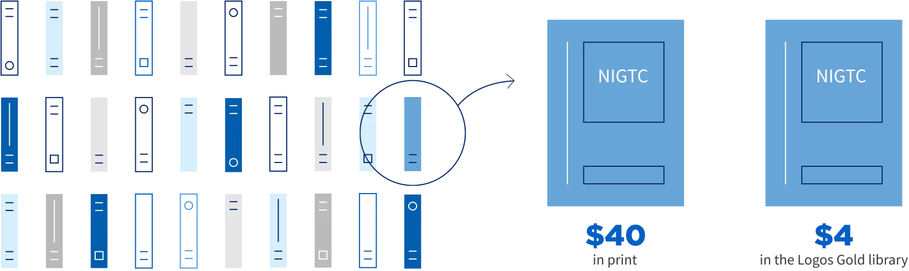
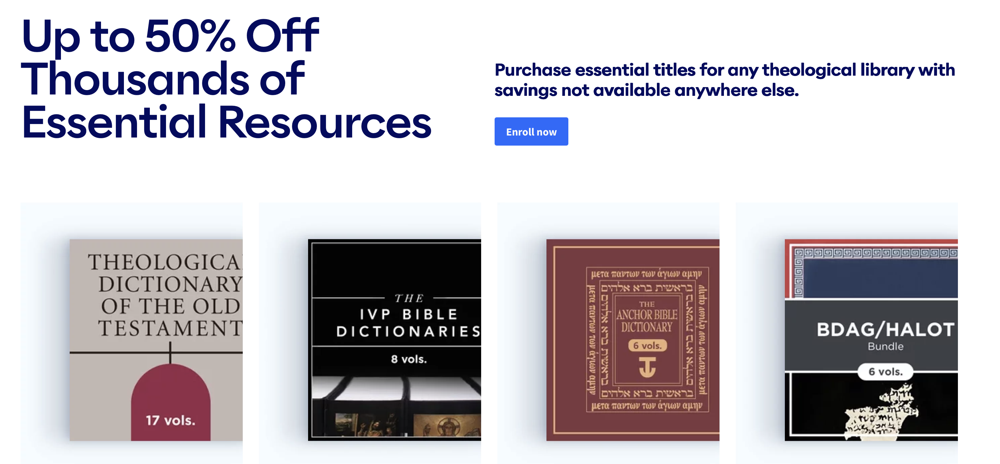
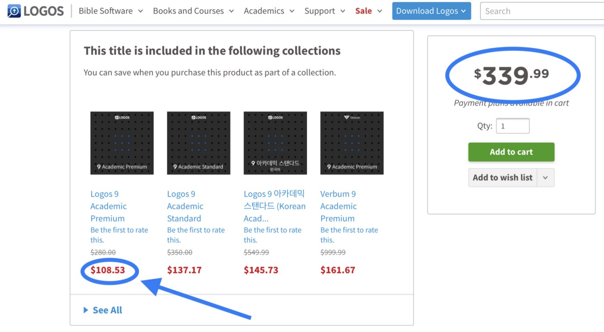






**Current Logos sales:** I cover this month's sales and coupon codes in my newsletter. Latest issue ({{ latest_issue.date | date: "%B %-d, %Y" }}): [{{ latest_issue.title }}]({{ latest_issue.url | relative_url }}).
{: .notice--info}


You’re here to find a discount and save money on Logos Bible Software. Maybe you are a student, pastor, missionary, or someone looking for a Logos discount code or coupon code. **I have good news: There are several ways to save money on Logos.**

In this post, I’m going to share my eight best tips to save money and get a discount on your Logos subscription and library.

## 1. ✨ Become a Logos Subscriber using [my partner link](https://logos.sjv.io/stapleton?sharedid=discounts) (Extended free trial and up to 30% off a library)

I am a Logos affiliate and this is a legitimate [special offer](https://logos.sjv.io/stapleton?sharedid=discounts) that will save you money.

Logos has been an invaluable tool in my ministry, seminary studies, sermon prep, and personal growth. I love telling others about why it’s well worth the investment.

In return for sending readers from my website to Logos, I get a small commission at no cost to you and you receive a valuable special offer!

[My partner link](https://logos.sjv.io/stapleton?sharedid=discounts) will get you an extended 60-day free trial on your Logos subscription and a 10-30% discount on your Logos library (depending on the time of year).

## 2. 🎁 Logos Subscriber Rewards

Beyond all the features you gain access to through your Logos subscription, you also get discount rewards! As a subscriber you receive:
- 5% store-wide discount on all books
- Earn a 5% annual reward coupon every February (Pro and Max subscriptions only)

If you subscribe using [my partner link](https://logos.sjv.io/stapleton?sharedid=discounts), you will receive an extended 60-day free trial on your Logos subscription.

## 3. 🗓️ Pay Annually for Your Logos Subscription

Beyond getting an extended 60-day free trial via [my partner offer](https://logos.sjv.io/stapleton?sharedid=discounts), you can get more free months by paying upfront. If you pay **annually**, Logos discounts your subscription. If you pay **two years** upfront, you get 24 months for the price of 19, which is **FIVE months free**. If you use [my link](https://logos.sjv.io/stapleton?sharedid=discounts), that five months turns effectively into **seven months FREE** (60-day trial + five free months).

🔥 That's effectively more than 35% off compared to paying month-to-month.

## 4. 📚 Buy a Logos Library

The best way to get the resources you want at a discount is to find them in Logos libraries. 

What is a Logos library? Well-rounded, deep discounted resources designed to help you accomplish your desired tasks. That’s it.

Some people avoid Logos libraries because of the sticker price, but that’s a mistake. While a library may contain resources you do not foresee using, they also include resources you want at a steep discount and will help optimize your Logos features. You can buy Logos resources a la carte, but you will almost certainly overspend.

If nothing else, you pay for the resources you want and get hundreds of others thrown in at little or no extra cost.

👀 **If you want help picking out a library, go read my [Logos Buyer’s Guide](https://www.nickstapleton.me/logos-buyers-guide/).**

## 5. 🎓 Academic Student Discount

If you're a seminary student, sign up for the [Logos Academic Discount](https://logos.sjv.io/eKOJPj?sharedid=discounts)! This student discount will get you 30% off of a Logos subscription AND library as well as up to 50% off of essential academic resources.

## 6. 📦 Is the resource you want included in a library?

Check this out: If I wanted to buy the _Dictionary of Classical Hebrew_ it would cost me $339.99, but if I buy the Logos Academic Premium Library I can get it and dozens of other resources thrown in for $108.53. 🤯

This is the glory of Logos libraries. If there are specific resources you want, check on the resource page to see if they’re included in any Logos base packages. This is the best way to get your resource, sometimes cheaper than its list price on its own _and_ get more resources thrown in for cheap (or free)!

Speaking of resources, if you are looking for recommendations, I have written about the six most important categories to prioritize and suggest 50+ resources to build out your Logos library [here](https://www.nickstapleton.me/logos-resources/).

## 7. 🆓 Grab the Free Book of the Month

Twice a month Logos gives away [a free book](https://logos.sjv.io/freebook?sharedid=discounts). Many times they are awesome. If you're a Logos subscriber, you will receive an extra free book every month!

[Subscribe to my newsletter](https://nickstapleton.ck.page/) and I will let you know about the free books so you never miss them. [Subscribe](https://nickstapleton.ck.page/) so you don't miss out.

## 8. Take advantage of the monthly sales

Logos runs a variety sales throughout the year. If you [subscribe to my newsletter](https://nickstapleton.ck.page/), I'll keep you posted on these special sales and Logos discount codes, especially when they apply to some of [my favorite key resources](https://logos.sjv.io/c/135250/2524153/26054?sharedid=discounts&u=https://www.logos.com/partner/nick-stapleton).

## Conclusion

Using these tips will help you save money on your Logos purchases. Ultimately, Logos is a worthy investment in your ministry, personal development, Bible study, and growth. And with [all its features](https://www.nickstapleton.me/Why-You-Should-Buy-Logos/), it makes every resource in your library better and will save you a significant amount of time and money in the long run.

Subscribe to my newsletter below and I will keep you posted on the latest Logos sales, free books, and discounted resources.

